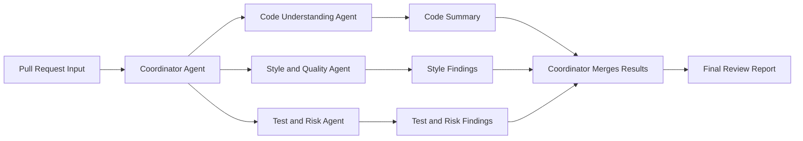

# Day 27 Diagram

## Step-by-step walkthrough
1. The Coordinator Agent receives the pull request.
2. The Coordinator sends the code changes to the Code Understanding Agent.
3. The Coordinator sends the same changes to the Style and Quality Agent.
4. The Coordinator sends testing-related information to the Test and Risk Agent.
5. Each specialist agent returns its findings.
6. The Coordinator merges all findings into one final review report.

## Why not one agent?
One agent can miss details because PR review needs different types of analysis at the same time. Splitting the work into specialist agents improves focus.

## Risk and mitigation
Risk:
- Cost and latency increase when multiple agents run.

Mitigation:
- The Coordinator should only call the agents that are actually needed for the current PR.
